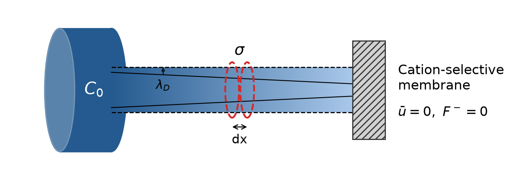
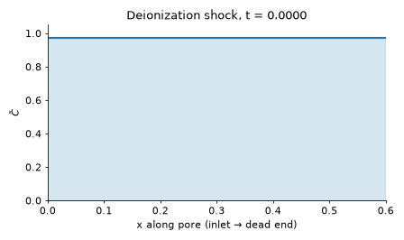
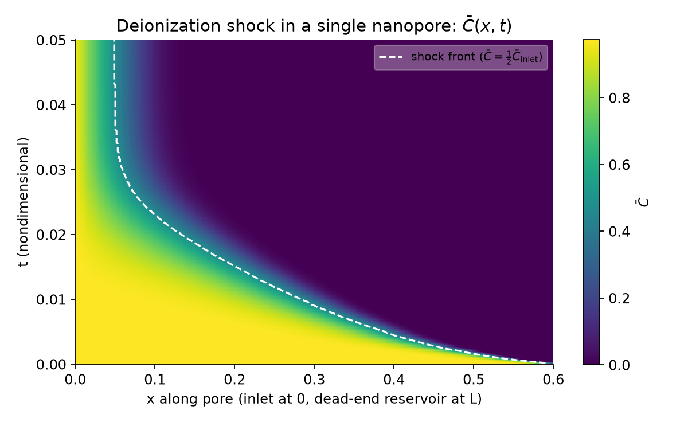
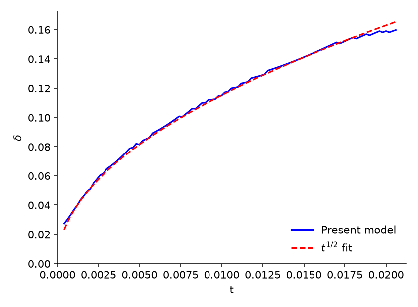
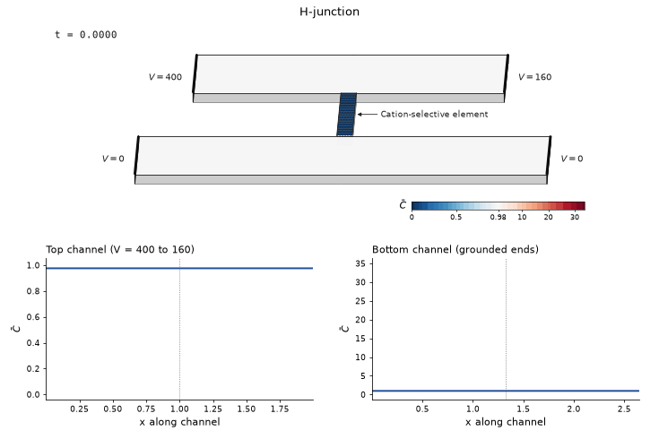
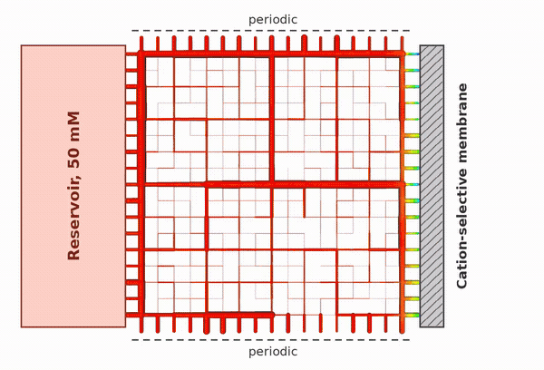
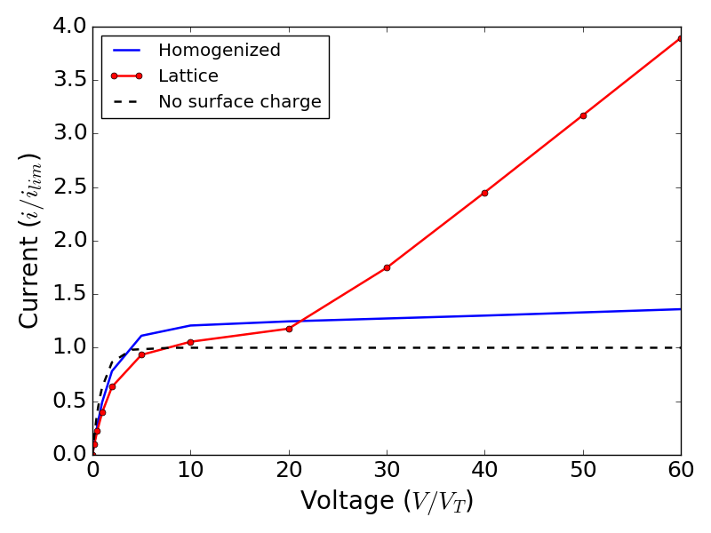

# Electrokinetic Porous Networks

A multiscale, reduced-order model of nonlinear electrokinetic transport in networks of microscale and nanoscale
pores. Fluid flow and ion transport are coupled and driven by gradients in pressure, electric potential and salt
concentration, through three mechanisms that act together and affect one another: pressure-driven flow,
electroosmosis and diffusio-osmosis.

**Single pore**: a charged pore with an inlet reservoir on one end and a dead end on the other. The dead end acts
as an ideal cation-selective membrane: cations pass through it, while anions and fluid cannot, so the
electroosmotic flow is balanced by an opposing pressure gradient and the net flow is zero. Under an applied
voltage a deionization shock forms at the dead end and moves through the pore toward the inlet.

<p>
  
  
</p>

Left: the pore, with the inlet reservoir on the left and the cation-selective membrane at the dead end on the
right. Right: the shock moving through the pore.

<p>
  
  
</p>

Left: C̄(x, t), black = depleted, dashed line = shock front. Right: shock thickness, which grows like t^1/2 while the front moves freely (shown up to its peak).

**H-junction** (3200 cells per channel and 30 in the element; V = 400 and 160 at the two ends of the top
channel, about 10 V and 4 V in the thesis setup; V = 0 at both ends of the bottom channel). A depletion shock
grows in the top channel next to the cation-selective element and an enriched zone forms in the bottom channel.
The geometry is inspired by lab-on-a-chip preconcentration devices ([Son et al., *BioChip J.* (2016)](https://doi.org/10.1007/s13206-016-0401-7)),
in particular the nanofluidic filter of [Wang, Stevens & Han, *Anal. Chem.* (2005)](https://doi.org/10.1021/ac050321z),
where a similar stationary depletion interface was observed in experiments.
Top: the two channels and the cation-selective element, colored by concentration. Bottom: concentration along
the top and bottom channels.



MP4 versions: `docs/figures/*.mp4`.

### Large-scale heterogeneous networks
The small, structured networks above, representative of lab-on-a-chip devices, are only one use of this code.
The same solver handles much larger heterogeneous porous media with thousands of pores, where pore sizes are
sampled from a log-normal distribution.

<p>
  
  
</p>

Left: evolution of the concentration field in a hierarchical lattice between a reservoir at the reference concentration (left;
C = 1, which is 50 mM KCl in the thesis) and a cation-selective membrane (right) under an applied field, with periodic boundaries at the top and bottom. Wide
main channels branch into progressively finer micro- and nanoscale pores, and each pore is solved with the same
reduced-order 1D model and implicit conservative scheme used in the examples above. Right: current-voltage
characteristics of the lattice medium (red line with markers at the simulated voltages), the equivalent
homogenized model (solid blue), and the diffusion-limited current (dashed black).

**Why the network matters.** The homogenized model is a bundle of identical, decoupled parallel pores with the
same effective pore size and surface conduction as the lattice. Because its pores cannot exchange fluid, its
only route above the limiting current is surface conduction, which is weak here, so its current barely rises
above the limit. In the lattice, pores of different sizes are connected, and the competition between
electroosmotic flow and backward pressure-driven flow creates internal flow loops even though the net flow
across the medium is zero. Beyond about V/V<sub>T</sub> = 20 these loops become advection-dominated (Péclet
number above 1), they carry salt toward the membrane, and the overlimiting conductance rises sharply. At
V/V<sub>T</sub> = 60 the lattice carries nearly three times the current of the homogenized model. Running the
same lattice with the flow turned off confirms that the difference comes from this induced advection. An
averaged model built from decoupled pores misses this behavior, and capturing it is the reason to resolve the
full network.

These large-scale results appear in my PhD thesis and in [Alizadeh, Bazant & Mani, *J. Colloid Interface Sci.* (2019)](https://doi.org/10.1016/j.jcis.2019.06.023), listed under [Citation](#citation). The network-generation code is not
included here for now. If you're interested in running these simulations, please email me; my contact
information is on my [GitHub profile](https://github.com/shimaalizadeh).

## About the model
Each pore is a 1D channel whose cross-section physics (electric double layer, surface charge, slit or circular
shape) is precomputed into look-up tables (`tables/`). The network couples these 1D pores through reservoirs
(nodes) that conserve ions, charge and fluid. This makes it possible to simulate phenomena such as concentration
polarization and deionization shocks, which need fine resolution along the pores, on networks that would be far
too expensive to resolve fully in 2D/3D. The model and its validation are described in the publications
listed under [Citation](#citation).

**Units.** The solver works in the dimensionless form used in the thesis (Alizadeh 2017, Sec. 2.2 and Table 2.1),
and all inputs, boundary conditions and outputs in this README are in these units unless a physical value is
given in parentheses. Lengths along a pore are scaled by a reference pore length L (a pore `length` of 1 means
L), concentrations by the reference reservoir concentration C<sub>ref</sub>, potentials by the thermal voltage
V<sub>T</sub> = k<sub>B</sub>T/(ze) (about 26 mV at room temperature), pressure by C<sub>ref</sub>k<sub>B</sub>T
and time by the diffusion time L<sup>2</sup>/D. The cross-section physics of each pore is set by two numbers: the dimensionless Debye
length `lambda_D` = λ<sub>ref</sub>/h<sub>p</sub>, where λ<sub>ref</sub> = (εk<sub>B</sub>T/(2C<sub>ref</sub>z<sup>2</sup>e<sup>2</sup>))<sup>1/2</sup>
and h<sub>p</sub> = area/perimeter (h/2 for a slit of gap h, R/2 for a circular pore of radius R), and the
dimensionless surface charge `sigma_star` = h<sub>p</sub>zeσ/(εk<sub>B</sub>T).

## Features
- Any network topology of slit and circular pores and reservoirs; surface charge, Debye length, area and
  initial concentration can be set per pore or per cell.
- Fixed potential/pressure reservoirs, closed reservoirs of finite volume, and dead-end pores.
- Outputs: concentration, pressure and electrochemical potential per cell, plus total current and flow over time.
- Inputs: a small TOML run file and a labeled `network.toml` with defaults (the legacy `Network.in` is still read).
- `ekpn-viz`: a Python package for plots, MP4/GIF animations, slit schematics, VTK/ParaView export and 3D rendering.

## Build
Requires a C++20 compiler, CMake >= 3.20, GNU make and LAPACK/BLAS (e.g. `liblapack-dev`). Ninja is optional
and used automatically when installed.

    make                  # build -> build/ek_solver (Release)
    make clean            # remove build/
    make rebuild          # clean, then build
    make TYPE=Debug       # Debug build

The `Makefile` is a thin wrapper around CMake; see it for the underlying `cmake` commands. `CMakePresets.json`
provides `release` and `debug` presets for IDEs.

## Quickstart

    build/ek_solver run_single_pore_network_toml.toml

This runs one charged slit pore (deionization shock) and should end with `I_tot = 23.2686`. The run file:

```toml
[network]
num_pores = 1
num_reservoirs = 2
num_horizontal_pores = 1

[solver]
dt = 1.0e-4
max_time = 1.0
write_every = 1000000     # snapshot (Tecplot_NNNN.bin) every N steps; time = NNNN * write_every * dt

[io]
tables_dir = "tables/"
network_file = "input_files/network.toml"   # .toml -> new reader, anything else -> legacy reader
```

The old positional form (`ek_solver P R H dt tmax write_every restart tables/ Network.in`) is still accepted.

## Input formats
**network.toml** (annotated schema: `input_files/network_schema.toml`; example: `input_files/network.toml`):

```toml
[defaults]                 # optional; applies to every entry
sigma_star = -200.0
lambda_D = 0.017

[[pores]]
id = 0
ends = [0, 1]              # [inlet reservoir, outlet reservoir]
length = 0.6
n_cells = 400

[[reservoirs]]
id = 0
pressure_known = true
potential_known = true
potential = 80.0
x = 0.0                    # optional layout for plots
y = 0.0
```

Precedence: entry field > `[defaults]` > built-in. Built-ins: pores `type = "slit"`, `dead_end = false`,
`area = 1.0`, `c0 = 1.0`; reservoirs `type = "slit"`, `c0 = 1.0`, `volume = 0.0`, `pressure = 0.0`.
Required: pore `id`, `ends`, `length`, `n_cells`, `sigma_star`, `lambda_D`; reservoir `id`, `pressure_known`,
`potential_known`, `potential`. Per-cell properties: add `profile = "cells.csv"` to a pore (header
`sigma_star,lambda_D,Sp,C0`, one row per cell). Both readers fill the same solver arrays, so results are
identical (checked on 5 example networks).

**Legacy Network.in** (column format, see `input_files/README.md`) is converted with

    python3 tools/network_in_to_toml.py input_files/Network.in -p 1 -r 2 -o network.toml
    python3 tools/network_in_to_toml.py OLD/Network.in -p 5 -r 6 --v0 --channels OLD/Channels.in   # older phd_codes format

## Visualization
Install the plotting package once (MP4 videos also need `ffmpeg`):

    python3 -m venv .venv && . .venv/bin/activate
    pip install -e .

Example: run the H-junction, then make its video. From the repo root:

    mkdir -p run/input_files && cp examples/hjunction_reference/network.toml run/input_files/
    ln -s ../tables run/tables
    cd run && ../build/ek_solver ../examples/hjunction_reference/run.toml > log.txt && cd ..

    ekpn-viz animate run --network run/input_files/network.toml --dt 1e-5 --write-every 50 \
        --paths "0,1;3,4" --shape slit --style clean --title "H-junction" \
        --path-names "Top channel (V = 400 to 160);Bottom channel (grounded ends)" \
        --hatch-pores 2 --pore-label "2:Cation-selective element" --prefix hjunction_slit

The run takes a few minutes and writes snapshots into `run/`. The last command saves an MP4 and a GIF in
`docs/figures/` (`hjunction_slit_C_bar.*`): the H-junction colored by concentration, with concentration along the top channel (pores 0
and 1) and the bottom channel (pores 3 and 4). `--dt` and `--write-every` must match the run file, so snapshot
numbers can be turned into times.

Other plots (`network`, `current`, 3D views) are listed in `ekpn-viz --help`.

## Examples
| Case | Files | What it shows |
|---|---|---|
| Single pore | `input_files/network.toml`, `examples/single_pore/` | deionization shock in a charged slit; I_tot = 23.2686 baseline |
| T-junction | `examples/tjunction/` | three pores meeting at an internal node |
| H-junction | `examples/hjunction_reference/` | two microchannels joined by a cation-selective element: depletion shock and enrichment |
| Flow loop | `examples/toy6_loop/` | six pores of two sizes forming a loop, where mismatched electroosmotic flow drives internal recirculation |
| Circular pore | `examples/circular_pore/` | the cylindrical counterpart of the single-pore slit case: one charged circular pore |
| Conical pore | `examples/conical_diode/` | a circular pore built from segments of increasing area, so the current depends on the voltage's sign (rectification) |

## Citation
If you use this code, please cite:
- S. Alizadeh, *Nonlinear Electrokinetic Transport in Microscale and Nanoscale Porous Structures*,
  PhD dissertation, Stanford University, 2017.
- S. Alizadeh, A. Mani, "Multiscale Model for Electrokinetic Transport in Networks of Pores, Part I: Model
  Derivation", *Langmuir* 33(25), 6205-6219 (2017). doi:10.1021/acs.langmuir.6b03816
- S. Alizadeh, A. Mani, "Multiscale Model for Electrokinetic Transport in Networks of Pores, Part II: Computational
  Algorithms and Applications", *Langmuir* 33(25), 6220-6231 (2017). doi:10.1021/acs.langmuir.7b00591
- S. Alizadeh, M. Z. Bazant, A. Mani, "Impact of Network Heterogeneity on Electrokinetic Transport in Porous Media",
  *Journal of Colloid and Interface Science* 553, 451-464 (2019). doi:10.1016/j.jcis.2019.06.023
  ([arXiv:1901.02525](https://arxiv.org/abs/1901.02525))
