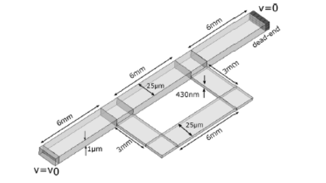
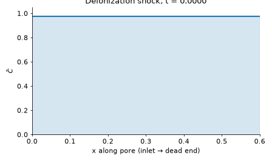
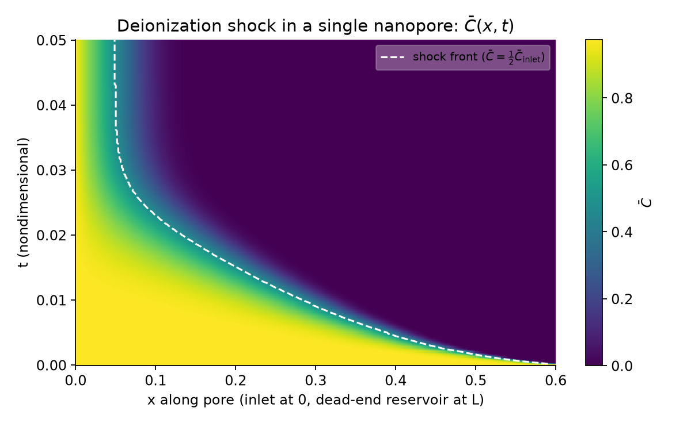
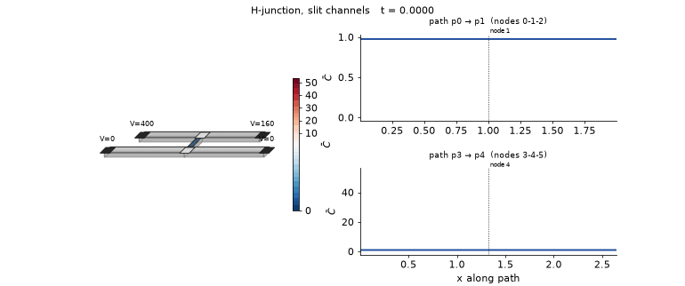
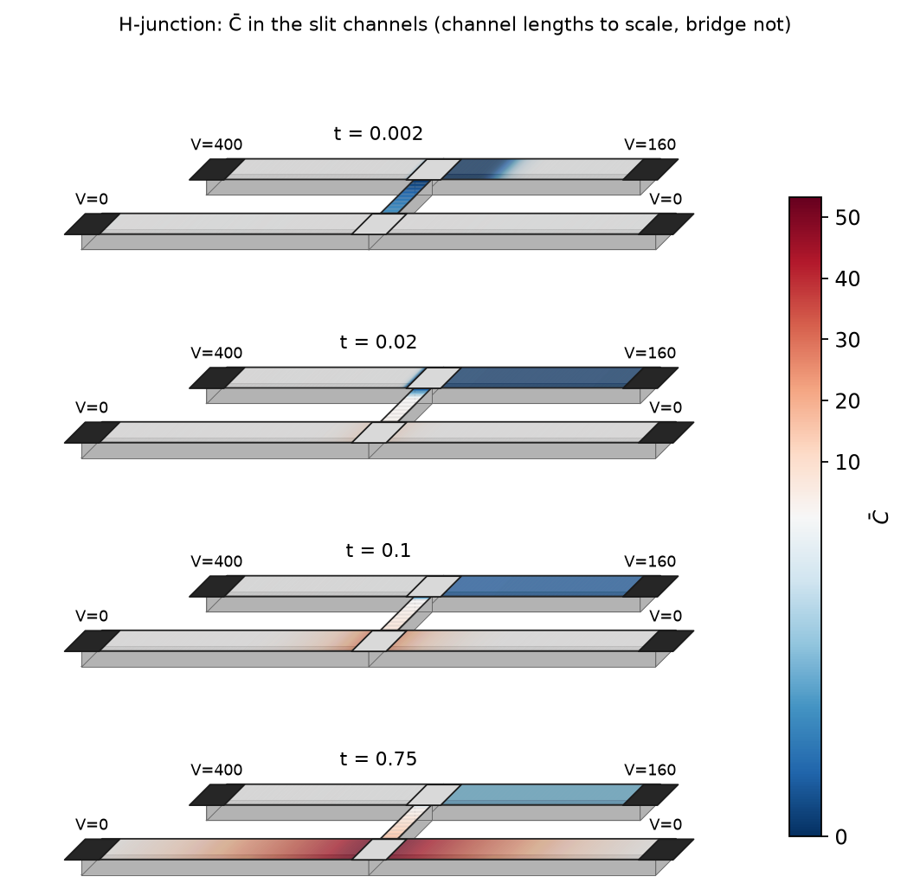

# Electrokinetic Porous Networks

A multiscale, reduced-order model of nonlinear electrokinetic transport (ion transport driven by electric fields
and pressure) in networks of microscale and nanoscale pores.

Each pore is a 1D channel whose cross-section physics (electric double layer, surface charge, slit or circular
shape) is precomputed into look-up tables (`tables/`). The network couples these 1D pores through reservoirs
(nodes) that conserve ions, charge and fluid. This makes it possible to simulate phenomena such as concentration
polarization and deionization shocks, which need fine resolution along the pores, on networks that would be far
too expensive to resolve fully in 2D/3D. The model and its validation are described in the publications
listed under [Citation](#citation).



## Features
- Any network topology of slit and circular pores and reservoirs; surface charge, Debye length, area and
  initial concentration can be set per pore or per cell.
- Fixed potential/pressure reservoirs, closed reservoirs of finite volume, and dead-end pores.
- Outputs: concentration, pressure and electrochemical potential per cell, plus total current and flow over time.
- Inputs: a small TOML run file and a labelled `network.toml` with defaults (the legacy `Network.in` is still read).
- `ekpn-viz`: a Python package for plots, MP4/GIF animations, slit schematics, VTK/ParaView export and 3D rendering.

## Build
Requires a C++20 compiler, CMake >= 3.20 and LAPACK/BLAS (e.g. `liblapack-dev`). Ninja is optional.

    cmake -S . -B build -G Ninja -DCMAKE_BUILD_TYPE=Release
    cmake --build build             # -> build/ek_solver

The legacy `Makefile` still works too.

## Quickstart

    build/ek_solver run_single_pore_network_toml.toml

This runs one charged slit pore (deionization shock) and should end with `I_tot = 23.2686`. The run file:

```toml
[network]
num_pores = 1
num_reservoirs = 2
num_horizontal_pores = 1

[solver]
dt = 1.0e-4
max_time = 1.0
write_every = 1000000     # snapshot (Tecplot_NNNN.bin) every N steps; time = NNNN * write_every * dt

[io]
tables_dir = "tables/"
network_file = "input_files/network.toml"   # .toml -> new reader, anything else -> legacy reader
```

The old positional form (`ek_solver P R H dt tmax write_every restart tables/ Network.in`) is still accepted.

## Input formats
**network.toml** (annotated schema: `input_files/network_schema.toml`; example: `input_files/network.toml`):

```toml
[defaults]                 # optional; applies to every entry
sigma_star = -200.0
lambda_D = 0.017

[[pores]]
id = 0
ends = [0, 1]              # [inlet reservoir, outlet reservoir]
length = 0.6
n_cells = 400

[[reservoirs]]
id = 0
pressure_known = true
potential_known = true
potential = 80.0
x = 0.0                    # optional layout for plots
y = 0.0
```

Precedence: entry field > `[defaults]` > built-in. Built-ins: pores `type = "slit"`, `dead_end = false`,
`area = 1.0`, `c0 = 1.0`; reservoirs `type = "slit"`, `c0 = 1.0`, `volume = 0.0`, `pressure = 0.0`.
Required: pore `id`, `ends`, `length`, `n_cells`, `sigma_star`, `lambda_D`; reservoir `id`, `pressure_known`,
`potential_known`, `potential`. Per-cell properties: add `profile = "cells.csv"` to a pore (header
`sigma_star,lambda_D,Sp,C0`, one row per cell). Both readers fill the same solver arrays, so results are
identical (checked on 5 example networks).

**Legacy Network.in** (column format, see `input_files/README.md`) is converted with

    python3 tools/network_in_to_toml.py input_files/Network.in -p 1 -r 2 -o network.toml
    python3 tools/network_in_to_toml.py OLD/Network.in -p 5 -r 6 --v0 --channels OLD/Channels.in   # older phd_codes format

## Visualization
Install the plotting package once (MP4 videos also need `ffmpeg`):

    python3 -m venv .venv && . .venv/bin/activate
    pip install -e .

Example: run the H-junction, then make its video. From the repo root:

    mkdir -p run/input_files && cp examples/hjunction_reference/network.toml run/input_files/
    ln -s ../tables run/tables
    cd run && ../build/ek_solver ../examples/hjunction_reference/run.toml > log.txt && cd ..

    ekpn-viz animate run --network run/input_files/network.toml --dt 1e-5 --write-every 50 \
        --paths "0,1;3,4" --shape slit

The run takes a few minutes and writes snapshots into `run/`. The last command saves an MP4 and a GIF in
`docs/figures/`: the H-junction coloured by concentration, with concentration along the top channel (pores 0
and 1) and the bottom channel (pores 3 and 4). `--dt` and `--write-every` must match the run file, so snapshot
numbers can be turned into times.

Other plots (`network`, `current`, 3D views) are listed in `ekpn-viz --help`.

## Examples
| Case | Files | What it shows |
|---|---|---|
| Single pore | `input_files/network.toml`, `examples/single_pore/` | deionization shock in a charged slit; I_tot = 23.2686 baseline |
| T-junction | `examples/tjunction/` | three pores meeting at an internal node |
| H-junction | `examples/hjunction_reference/` | two microchannels joined by a nanochannel: depletion shock and enrichment |
| H-junction (phd_codes input) | `examples/hjunction_phd_codes/` | the converted original input; needs the fine mesh to be stable |
| Others | `examples/toy6_loop`, `circular_pore`, `conical_diode`, `hjunction` | flow loop, circular pore, conical pore |

**Single pore**: the shock front moves into the pore and then stops.




**H-junction** (3200/30/3200 cells, V = 400 / 160 on the top channel, bottom grounded). A depletion shock
grows in the top channel next to the nanochannel and an enriched zone forms in the bottom channel.




MP4 versions: `docs/figures/*.mp4`.

## Citation
If you use this code, please cite:
- S. Alizadeh, *Nonlinear Electrokinetic Transport in Microscale and Nanoscale Porous Structures*,
  PhD dissertation, Stanford University, 2017.
- S. Alizadeh, A. Mani, "Multiscale Model for Electrokinetic Transport in Networks of Pores, Part I: Model
  Derivation", *Langmuir* 33(25), 6205-6219 (2017). doi:10.1021/acs.langmuir.6b03816
- S. Alizadeh, A. Mani, "Multiscale Model for Electrokinetic Transport in Networks of Pores, Part II: Computational
  Algorithms and Applications", *Langmuir* 33(25), 6220-6231 (2017). doi:10.1021/acs.langmuir.7b00591
